  
  
  
  
  
   
  
  
  
  
  
  

### What I can do

<table>
<tr>
<td width="33%" valign="top">

**LLM products** 
Claude and Gemini inside real workflows: clinical drafts a doctor signs, a WhatsApp agent that sells.

</td>
<td width="33%" valign="top">

**Computer vision** 
Detection on a club's existing cameras; prescription photos read and priced.

</td>
<td width="33%" valign="top">

**Full-stack products** 
Next.js, FastAPI and PostgreSQL apps people use every day, from a farm to a medical practice.

</td>
</tr>
<tr>
<td width="33%" valign="top">

**Payments and messaging** 
PayPal, Google Meet, Twilio and WhatsApp wired into one flow that runs on its own.

</td>
<td width="33%" valign="top">

**Data and analytics** 
Churn and refill prediction, weight gain and money per lot, key-person risk.

</td>
<td width="33%" valign="top">

**AI-built software, done carefully** 
My own harness: mockups first, review by a different agent, test output on record.

</td>
</tr>
</table>

### Selected work

<table>
<tr>
<td width="50%" valign="top">

#### AnestIA  private · client
`TypeScript · pgvector · Claude API`

Reads patient history and lab PDFs, drafts the pre-anesthesia document, and the
anesthesiologist corrects and signs. Vision runs only on scans, about 80% cheaper.

</td>
<td width="50%" valign="top">

#### [Sellix AI](https://github.com/jherrerae16/Sellix-AI)  public · [live demo](https://sellix-ai-mvp.vercel.app)
`Next.js · Redis · Gemini · Twilio`

Pharmacy sales data turned into decisions: churn, refills, cross-sell. A two-way
WhatsApp inbox where a photographed prescription comes back priced.

</td>
</tr>
<tr>
<td width="50%" valign="top">

#### SOFIA  private · in production
`Next.js 16 · Prisma · PostgreSQL`

Runs a working feedlot in Colombia: weigh-ins, paddocks, health events, purchase
and sale prices per kilo. Used every day on the farm. 428 unit and 118 browser tests.

</td>
<td width="50%" valign="top">

#### Medical practice platform  private · client
`Next.js · Prisma · PostgreSQL · PayPal`

International consultations end to end: the patient registers from a personal link,
pays by PayPal, and the Google Meet and WhatsApp confirmation go out on their own.

</td>
</tr>
<tr>
<td width="50%" valign="top">

#### VigilancIA  private · in production
`Python · YOLOX · FastAPI · PostgreSQL`

AI video analytics over a residential club's 37 existing cameras, running on the
site's own hardware. 0.7 s median latency in the live test.

</td>
<td width="50%" valign="top">

#### JD²  private
`JavaScript · Node · 189 tests`

My harness for building software with AI agents: reopenable gates, review by an
agent that did not write the code, and test output on record before anything ships.

</td>
</tr>
</table>

Also: **Knowledge Intelligence**, key-person risk for a tech company, and **BANKO**, personal finance
across Colombia and the US. Both private and paused. Happy to walk through any private project in a conversation.

### How I build

- Screens are approved as mockups before code is written.
- An agent that did not write the change reviews it.
- "Tests pass" means the command, its output and the exit code are on record.

---

  Looking for a <b>Summer 2027 software engineering internship</b> · Backend · Applied AI · Distributed systems 
  <a href="https://www.linkedin.com/in/juanherrera-dev/">LinkedIn</a> ·
  <a href="mailto:jdh272@miami.edu">jdh272@miami.edu</a> ·
  Coral Gables, FL

